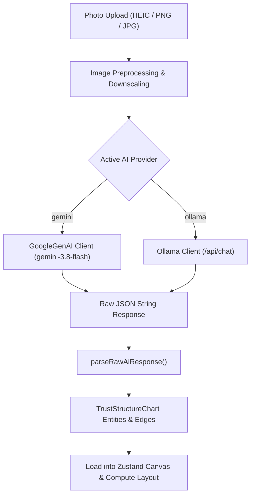

# Design Specification: Ollama Vision OCR Integration & Progress Feedback

**Document Date:** 2026-11-01  
**Status:** Approved for Implementation Planning  
**Target:** JERMChart Vision OCR & AI Configuration Subsystem  

---

## 1. Executive Summary

JERMChart currently relies exclusively on Google Gemini for handwritten and drawn structure chart vision OCR. While effective, this creates a cloud dependency and requires users to transmit confidential client structure charts to external servers.

This specification introduces **Ollama as a first-class local AI provider**, enabling 100% private, air-gapped, zero-cloud-egress diagram transcription. In addition, this specification resolves an observed UI responsiveness defect where the import modal appeared frozen or "hung" during image processing and inference by adding a dedicated real-time progress overlay with step indicators, an elapsed time counter, and request cancellation.

---

## 2. Goals & Non-Goals

### Goals
1. **Multi-Provider AI Architecture:** Support both `gemini` (Google Cloud AI) and `ollama` (Local / Self-Hosted AI) interchangeably for chart vision transcription.
2. **Dynamic Ollama Model Discovery:** Automatically fetch installed models from the user's Ollama instance via `GET /api/tags` and distinguish vision-capable models with a prominent `[Vision]` badge.
3. **Defense-in-Depth Security Firewall:** Update Electron's egress firewall in `electron/main.cjs` to permit local and private-network Ollama endpoints (`localhost`, `127.0.0.1`, and private LAN subnets) strictly restricted to approved Ollama API paths (`/api/tags`, `/api/chat`, `/api/version`), preventing SSRF and internal port scanning.
4. **Interactive Processing Experience:** Eliminate UI "freeze" perceptions in `PhotoImportModal` by replacing the modal content during analysis with an animated spinner, live multi-step status messages, an active elapsed timer, and an abort controller.
5. **Seamless Data Conversion:** Adapt Ollama's vision output to the existing `parseRawAiResponse()` pipeline to ensure consistent node generation, UUID allocation, and directional relationship mapping.

### Non-Goals
* Running an embedded Ollama daemon inside the Electron binary (Ollama remains an external service managed by the user).
* Supporting text-only completion features outside the structure chart transcription workflow.
* Supporting deprecated legacy providers (OpenAI remains deprecated).

---

## 3. Architecture & Data Flow



---

## 4. Component & Service Specifications

### 4.1 Configuration Layer (`src/services/ai/aiConfig.ts`)
Update `AIConfig` to support provider discrimination and Ollama endpoints:

```typescript
export type AIProvider = 'gemini' | 'ollama';

export interface AIConfig {
  provider: AIProvider;
  apiKey: string;
  model: string;
  ollamaUrl: string;
}

export const DEFAULT_AI_CONFIG: AIConfig = {
  provider: 'gemini',
  apiKey: '',
  model: 'gemini-3.8-flash',
  ollamaUrl: 'http://localhost:11434',
};
```

* **Validation Function (`hasValidAIConfig(config?: AIConfig)`):**
  - If `provider === 'gemini'`: Returns `true` if `apiKey.trim().length > 0` and `model.trim().length > 0`.
  - If `provider === 'ollama'`: Returns `true` if `ollamaUrl.trim().length > 0` and `model.trim().length > 0` (no API key required).

### 4.2 Ollama Client Service (`src/services/ai/ollamaService.ts`)
A dedicated service module implementing Ollama HTTP communications:

1. **`fetchOllamaModels(baseUrl: string): Promise<OllamaModelItem[]>`**
   * Endpoint: `GET ${sanitizeUrl(baseUrl)}/api/tags`
   * Timeout: 5000ms using `AbortSignal.timeout`.
   * Vision Detection Logic:
     Checks model name and model details family against vision patterns:
     `['vision', 'llava', 'minicpm', 'qwen2.5-vl', 'qwen-vl', 'moondream', 'mllama', 'bakllava']`.
   * Returns:
     ```typescript
     export interface OllamaModelItem {
       name: string;
       isVisionCapable: boolean;
       size: number;
       parameterSize?: string;
     }
     ```

2. **`testOllamaConnection(baseUrl: string, model: string): Promise<ConnectionTestResult>`**
   * Checks `GET ${baseUrl}/api/version`.
   * Checks whether `model` exists in the list from `GET /api/tags`.
   * Returns descriptive diagnostic messages for connection refusal, missing model, or verified ready status.

3. **`callOllamaVision(base64Image: string, mimeType: string, config: AIConfig, signal?: AbortSignal): Promise<string>`**
   * Strips any Data URI scheme prefix (`data:image/...;base64,`).
   * Sends `POST ${config.ollamaUrl}/api/chat` with:
     ```json
     {
       "model": config.model,
       "messages": [
         { "role": "system", "content": SYSTEM_INSTRUCTION },
         {
           "role": "user",
           "content": "Analyze this structure chart and extract all entities, relationships, and metadata strictly following the schema.",
           "images": [base64Image]
         }
       ],
       "format": "json",
       "stream": false,
       "options": {
         "temperature": 0.1
       }
     }
     ```
   * Extracts `response.message.content` and returns the clean JSON string.

### 4.3 Unified Chart Vision Service (`src/services/ai/chartVisionService.ts`)
* `analyzeChartImage(base64Image, mimeType, config, signal?)`:
  * Dispatches to `callGeminiVision` or `callOllamaVision` based on `config.provider`.
  * Passes the raw output to `parseRawAiResponse(jsonText)`.

### 4.4 Electron Security Firewall (`electron/main.cjs`)
To safeguard against SSRF and local port scanning:
* Update `isAllowedUrl(rawUrl, isDevelopment)`:
  * Restrict Ollama endpoints strictly to `ALLOWED_OLLAMA_PATHS = new Set(['/api/tags', '/api/chat', '/api/version'])`.
  * Validate that the host is either:
    1. Loopback: `localhost`, `127.0.0.1` (with standard or user-configured ports).
    2. RFC 1918 Private LAN: `192.168.x.x`, `10.x.x.x`, `172.16.x.x`–`172.31.x.x`.
  * Reject any other path or external host.
  * Guarantee linear-time evaluation with zero backtracking regex.

### 4.5 Settings Modal UI (`src/components/settings/SettingsModal.tsx`)
* **Provider Toggle:** Tabs/Radio selector between **Google Gemini** and **Ollama (Local / Private)**.
* **Ollama View:**
  * Server URL input with "Refresh Models" trigger button.
  * Model dropdown listing all models from Ollama with `[Vision]` badges on capable models.
  * Informational advisory when a non-vision model is selected.
  * Single "Test Connection" button calling the unified test service.
  * Elimination of API key field when Ollama is selected.

### 4.6 Photo Import Modal UI & Progress Feedback (`src/components/import/PhotoImportModal.tsx`)
* **Elimination of Frozen UI / Hung State:**
  * When `isProcessing = true`, render an animated **Processing Card**:
    * Large spinning `Loader2` / pulsing icon.
    * Real-time multi-step state indicator:
      1. *"Preprocessing & optimizing image..."*
      2. *"Connecting to [Google Gemini / Local Ollama]..."*
      3. *"Transcribing handwritten entities and relationships..."*
      4. *"Calculating automatic hierarchy and canvas layout..."*
    * Live elapsed timer (`Elapsed: 7s`).
    * "Cancel Analysis" button wired to an `AbortController`.
  * Fix `ConfirmReplaceNotice` so confirming replacement immediately switches into the Processing Card.

---

## 5. Security & Fiduciary Privacy Risk Assessment

| Risk | Level | Mitigation |
| :--- | :--- | :--- |
| **Cloud Egress of Client Data** | High (Gemini) | Ollama provides 100% on-premise execution with zero outbound internet traffic. |
| **SSRF via `localhost` Whitelist** | Medium | Only approved paths (`/api/tags`, `/api/chat`, `/api/version`) on HTTP/HTTPS are allowed; all other internal services/ports remain blocked. |
| **Inference Denial of Service (OOM/Hang)** | Low | Main-thread canvas conversion is bounded, Ollama requests carry 90-second timeout and user-cancellable `AbortController`. |
| **Malformed Model Output** | Low | Robust sanitization in `parseRawAiResponse` with fallback defaults for missing entities/edges. |

---

## 6. Testing & Quality Strategy

1. **Unit Tests (`src/__tests__/services/ollamaService.test.ts`):**
   * Mock `fetch` to test successful `/api/tags` parsing and vision badge detection.
   * Test connection diagnostic results (success, wrong model, network down).
   * Test `callOllamaVision` payload formatting and JSON response extraction.
2. **Firewall Tests (`src/__tests__/electron/main.test.ts`):**
   * Verify that `http://localhost:11434/api/tags` and `http://localhost:11434/api/chat` are permitted.
   * Verify that arbitrary paths on localhost (e.g. `http://localhost:5432/` or `http://localhost:11434/admin`) are blocked.
   * Verify that external hosts remain blocked.
3. **Component Tests:**
   * Test `SettingsModal.test.tsx` for provider toggling and Ollama model population.
   * Test `PhotoImportModal.test.tsx` for processing spinner, step progression, and abort button handling.
4. **Gates:**
   * Must pass `npm run verify:pre-commit` (ESLint 0 errors, Sonar cognitive complexity < 15, 100% test coverage).
   * Must pass `npm run verify:pre-push` (Vite production build, 0 moderate or higher vulnerabilities).
